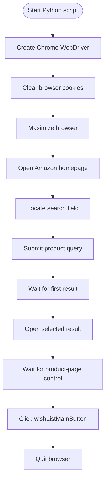

<div align="center">

# 🛒 Amazon Cart Automation

### 🐍 Python · 🌐 Selenium WebDriver · 🤖 Browser Automation

A small, educational browser-automation project demonstrating how Python and Selenium can control a Chrome browser, search for a product, and interact with a product page.

[](https://www.python.org/)
[](https://www.selenium.dev/)
[](LICENSE)
[](https://github.com/Brajesh31/Amazon-Automation/actions/workflows/ci.yml)
[](https://github.com/Brajesh31/Amazon-Automation/actions/workflows/update-readme.yml)

[📖 Documentation](docs/README.md) · [🧭 Roadmap](ROADMAP.md) · [🤝 Contributing](CONTRIBUTING.md) · [🔐 Security](SECURITY.md)

</div>

---

> [!WARNING]
> **Prototype, not a production shopping bot.** The current code clicks an element named `wishListMainButton`. It does not verify that a product was added to the cart. Do not use this project to bypass authentication, CAPTCHAs, rate limits, fraud controls, or purchase safeguards.

## 📌 Table of Contents

- [🌟 Project Overview](#-project-overview)
- [✨ What It Demonstrates](#-what-it-demonstrates)
- [⚙️ How It Works](#️-how-it-works)
- [🧱 Project Structure](#-project-structure)
- [🛠️ Tech Stack](#️-tech-stack)
- [📋 Requirements](#-requirements)
- [🚀 Installation](#-installation)
- [▶️ Run the Project](#️-run-the-project)
- [🔧 Configuration](#-configuration)
- [🧪 Validation](#-validation)
- [⚠️ Known Limitations](#️-known-limitations)
- [🔐 Responsible Use](#-responsible-use)
- [📚 Documentation](#-documentation)
- [🗺️ Roadmap](#️-roadmap)
- [🤝 Contributing](#-contributing)
- [📄 License](#-license)

## 🌟 Project Overview

**Amazon Cart Automation** is a compact Python project built with Selenium WebDriver. It demonstrates browser startup, page navigation, locating page elements, submitting a search form, waiting for a result, and interacting with a product-page control.

The repository is useful as a starting point for learning browser automation concepts. It is not a stable integration with Amazon and should not be treated as an unattended shopping utility.

### 📊 Project Snapshot

| Attribute | Details |
|---|---|
| 🐍 Language | Python |
| 🌐 Automation | Selenium WebDriver |
| 🖥️ Browser | Google Chrome |
| 📄 Entry point | `main.py` |
| 🧩 Main component | `AmazonCartAutomation` |
| 🗃️ Persistence | None |
| 🛢️ Database | None |
| 🔌 HTTP API | None |
| 🧪 Automated behavior tests | Not currently implemented |
| 🚦 CI validation | Python syntax, dependency and documentation checks |
| 📦 License | MIT |

## ✨ What It Demonstrates

- 🌐 Launching and controlling a Chrome browser with Selenium.
- 🧹 Starting a browser session and clearing its cookies.
- 🔎 Locating a search field and submitting a product query.
- ⏳ Waiting for a page element with Selenium's explicit wait support.
- 🖱️ Clicking a product result and a product-page control.
- 🧱 Organizing a small automation flow inside a Python class.

**Important distinction:** these are the interactions attempted by the current source. A successful click is not proof of a successful cart update.

## ⚙️ How It Works

The current `main.py` follows this sequence:

1. 🧰 Create an `AmazonCartAutomation` object and start Chrome.
2. 🧹 Clear cookies in the newly created browser session.
3. 🪟 Maximize the browser window.
4. 🏠 Open `https://www.amazon.com/`.
5. 🔎 Locate the search input using `twotabsearchtextbox`.
6. ⌨️ Submit the search phrase `Wireless Earbuds`.
7. 📦 Click a search result using a hard-coded absolute XPath.
8. 🖱️ Click the element identified as `wishListMainButton`.
9. 🧹 Quit Chrome on the normal execution path.

### 🔄 Execution Flow



The diagram reflects the current code path. It does not mean the final control adds an item to the cart. An exception can also interrupt the sequence before browser cleanup.

## 🧱 Project Structure

```text
Amazon-Automation/
│
├── 📁 .github/
│   ├── 📁 ISSUE_TEMPLATE/
│   │   ├── bug_report.yml
│   │   ├── feature_request.yml
│   │   └── config.yml
│   ├── 📁 workflows/
│   │   ├── ci.yml
│   │   └── update-readme.yml
│   ├── dependabot.yml
│   └── PULL_REQUEST_TEMPLATE.md
│
├── 📁 Drivers/
│   └── chromedriver
│
├── 📁 docs/
│   ├── README.md
│   ├── architecture.md
│   ├── api.md
│   ├── browser-and-driver.md
│   ├── configuration.md
│   ├── database.md
│   ├── deployment.md
│   ├── development.md
│   ├── faq.md
│   ├── installation.md
│   ├── limitations.md
│   ├── operations.md
│   ├── security-and-privacy.md
│   ├── testing.md
│   ├── troubleshooting.md
│   └── workflow.md
│
├── 📄 main.py
├── 📄 requirements.txt
├── 📄 .env.example
├── 📄 .gitignore
├── 📄 .editorconfig
├── 📄 README.md
├── 📄 LICENSE
├── 📄 CHANGELOG.md
├── 📄 ROADMAP.md
├── 📄 CONTRIBUTING.md
├── 📄 CODE_OF_CONDUCT.md
├── 📄 SECURITY.md
├── 📄 SUPPORT.md
├── 📄 CITATION.cff
└── 📄 CODEOWNERS
```

> 📎 The tracked `Drivers/chromedriver` is a platform-specific executable. It may not match your operating system or installed Chrome version. The source currently stores a machine-specific path but does not pass it to `ChromeService`. See [Browser and Driver Management](docs/browser-and-driver.md).

## 🛠️ Tech Stack

| Technology | Role |
|---|---|
| 🐍 [Python](https://www.python.org/) | Main programming language |
| 🧪 [Selenium](https://www.selenium.dev/) | Browser automation framework |
| 🌐 [Google Chrome](https://www.google.com/chrome/) | Browser controlled by the script |
| 🔧 [ChromeDriver](https://developer.chrome.com/docs/chromedriver/) / Selenium Manager | WebDriver connectivity and driver discovery |
| 🐙 [GitHub Actions](https://github.com/features/actions) | Repository validation workflows |

## 📋 Requirements

Before starting, make sure you have:

- ✅ Python 3.10 or newer.
- ✅ Git installed.
- ✅ Google Chrome installed.
- ✅ Selenium dependencies installed from `requirements.txt`.
- ✅ A compatible ChromeDriver or working Selenium Manager setup.
- ✅ Authorization to run browser automation in the target environment.

## 🚀 Installation

### 1. Clone the repository

```bash
git clone https://github.com/Brajesh31/Amazon-Automation.git
cd Amazon-Automation
```

### 2. Create a virtual environment

```bash
python -m venv .venv
```

### 3. Activate the environment

**Windows PowerShell**
```powershell
.venv\\Scripts\\Activate.ps1
```

**Windows Command Prompt**
```bat
.venv\\Scripts\\activate.bat
```

**macOS / Linux**
```bash
source .venv/bin/activate
```

### 4. Install dependencies

```bash
python -m pip install --upgrade pip
python -m pip install -r requirements.txt
```

### 5. Verify the installation

```bash
python --version
python -m pip show selenium
python -m pip check
```

Install Chrome separately. Review the driver setup before running the script.

## ▶️ Run the Project

From the repository root:

```bash
python main.py
```

This launches a visible browser and contacts a live external website. The search phrase is hard-coded in the current entry point. Do not use a personal shopping or payment account. Prefer local mock pages for development and tests.

## 🔧 Configuration

The current program does not load environment variables or a configuration file. The target URL, search phrase, selectors and wait durations are embedded in `main.py`. The `.env.example` file is informational only.

Never place credentials, session cookies, browser profiles, payment information or personal data in source files or example configuration.

## 🧪 Validation

Run the local checks:

```bash
python -m py_compile main.py
python -m pip check
```

GitHub Actions validates Python syntax, dependency consistency and required documentation files. It does not launch Amazon or prove that live selectors work.

| Workflow | Purpose |
|---|---|
| 🧪 [CI](.github/workflows/ci.yml) | Install dependencies, check packages and compile Python |
| 📚 [Documentation Integrity](.github/workflows/update-readme.yml) | Confirm required documentation files exist |

## ⚠️ Known Limitations

| Issue | Impact |
|---|---|
| 📍 Hard-coded driver path | Not portable between machines |
| 🔌 Driver path not passed to `ChromeService` | Configured path may not be used |
| 📦 Bundled platform-specific driver | May be incompatible with installed Chrome or OS |
| 🧭 Absolute XPath | Breaks when page layout or result order changes |
| 🛒 Unverified final control | Does not prove an item was added to the cart |
| 🧹 Cleanup only on normal path | Browser may remain open after an exception |
| 🧪 No behavior test suite | Browser flow is not automatically verified |
| 🌍 Live external dependency | Markup, consent and access conditions may change |

These are current engineering gaps, not supported features. See [Known Limitations](docs/limitations.md) and [Roadmap](ROADMAP.md).

## 🔐 Responsible Use

This project is intended for learning and authorized browser testing.

- 🛡️ Respect website terms, applicable laws and access restrictions.
- 🚫 Do not bypass CAPTCHA, authentication, MFA, rate limits or anti-bot controls.
- 💳 Do not automate checkout, payment, purchasing or account creation.
- 🔒 Do not store cookies, credentials, payment information or personal data.
- 🧪 Prefer local mock pages or explicitly approved test environments.
- 🛑 Stop when a site blocks or challenges automation.

Read [SECURITY.md](SECURITY.md) and [Security and Privacy](docs/security-and-privacy.md) before extending the workflow.

## 📚 Documentation

| Guide | What you will find |
|---|---|
| 📖 [Documentation Index](docs/README.md) | Complete guide directory |
| 🏗️ [Architecture](docs/architecture.md) | Components and execution boundaries |
| 💻 [Installation](docs/installation.md) | Environment setup |
| 🧑‍💻 [Development](docs/development.md) | Development workflow and standards |
| 🌐 [Browser and Driver](docs/browser-and-driver.md) | Chrome and Selenium configuration |
| ⚙️ [Configuration](docs/configuration.md) | Current and proposed settings |
| 🔄 [Workflow](docs/workflow.md) | Step-by-step browser interactions |
| 🔌 [Python Interface](docs/api.md) | Class methods, no HTTP API |
| 🧪 [Testing](docs/testing.md) | Static and mock-based testing |
| 🔐 [Security and Privacy](docs/security-and-privacy.md) | Data handling and safe use |
| 🚀 [Deployment](docs/deployment.md) | Local and CI execution |
| 🧰 [Operations](docs/operations.md) | Runbook and cleanup |
| ⚠️ [Limitations](docs/limitations.md) | Known implementation gaps |
| ❓ [FAQ](docs/faq.md) | Common questions |
| 🗃️ [Database](docs/database.md) | Current lack of persistence |
| 🩺 [Troubleshooting](docs/troubleshooting.md) | Common failures |

## 🗺️ Roadmap

The next engineering priorities are:

- [ ] 🔧 Make browser and driver setup portable.
- [ ] 🧹 Guarantee browser cleanup on exceptions.
- [ ] 🎯 Replace fragile selectors with testable selectors.
- [ ] 🧪 Add unit tests and local mock-page fixtures.
- [ ] 🧩 Separate browser lifecycle from page interactions.
- [ ] 📋 Add structured, privacy-conscious diagnostics.

See the complete [Roadmap](ROADMAP.md).

## 🤝 Contributing

Contributions are welcome when they improve correctness, maintainability, accessibility of the documentation or safe testability.

1. 📖 Read [CONTRIBUTING.md](CONTRIBUTING.md).
2. 🧭 Check the roadmap and existing issues.
3. 🧪 Validate changes with mock pages or an approved environment.
4. 🔍 Review your diff for secrets and personal data.
5. 📝 Update documentation when behavior changes.

## 📄 License

Released under the **MIT License**.

Copyright © 2025 **Brajesh Kumar**. See [LICENSE](LICENSE).

---

<div align="center">

### ⭐ Learning Selenium? Explore the code, understand the limitations, and improve it responsibly.

[⬆️ Back to top](#-amazon-cart-automation)

</div>
